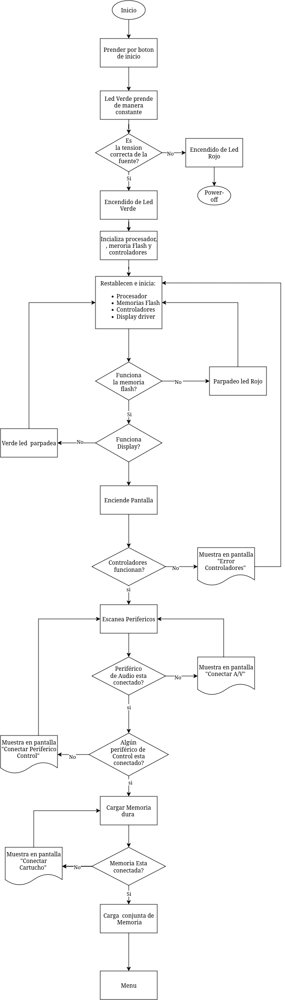
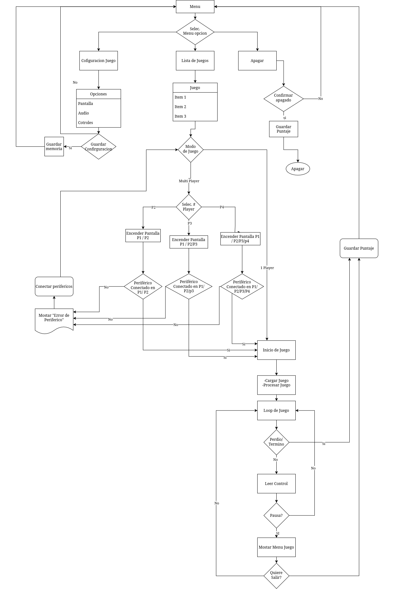
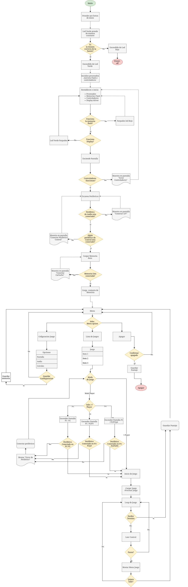
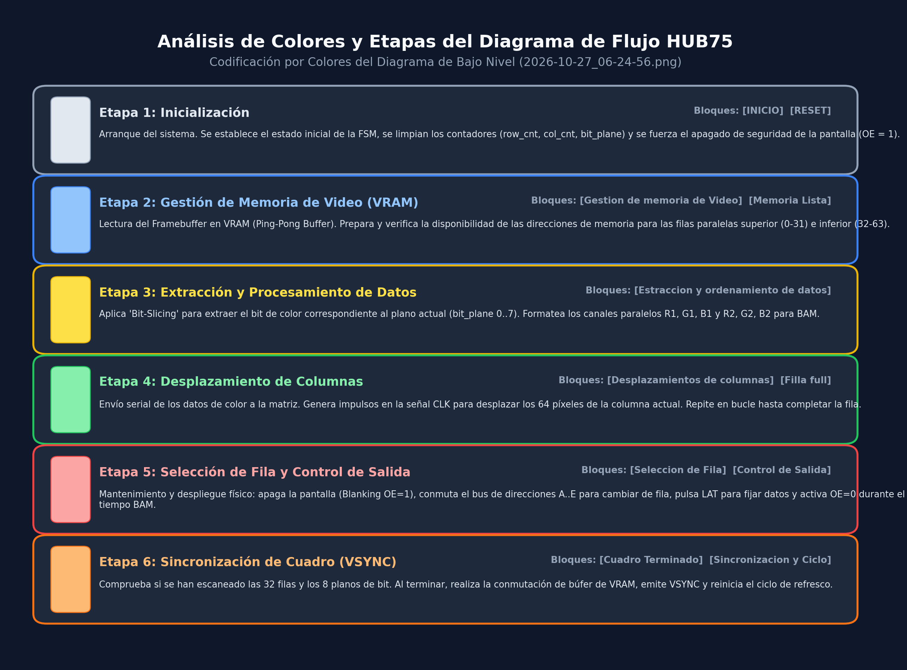

# Diagrama de bloques del sistema

## Introducción

El presente diagrama de bloques representa de manera general la arquitectura y el flujo de funcionamiento de una consola de videojuegos, desde su encendido e inicialización hasta la ejecución de los juegos y las diferentes funciones disponibles para el usuario.

El sistema se organiza en diferentes etapas que permiten representar el proceso de inicio, la carga del sistema, la interacción con la pantalla, la gestión de memoria, el manejo de periféricos, la selección y ejecución de juegos, las opciones de configuración, el funcionamiento multijugador y los procesos de recuperación ante errores o reinicio del sistema.

Los diagramas se han dividido en diferentes niveles para facilitar la comprensión de la operación general y posteriormente detallar cada uno de sus procesos.

## Diagrama  del Inicio del sistema

## Menú  del sistema

El siguiente diagrama representa la estructura de navegación de la consola, incluyendo el acceso a la lista de juegos, configuración, modo multijugador y las opciones de salida del sistema.

## Menu General

## Display 

### 1. Desglose Paso a Paso por Bloques del Diagrama

#### 1. `INICIO`
* **Definición**: Punto de arranque e inicialización global del sistema.
* **Función**: Representa la energización o el encendido inicial de la lógica de control (FPGA / Microcontrolador).

#### 2. `RESET`
* **Definición**: Estado de reinicio del hardware y restauración del camino de datos (*datapath*).
* **Operaciones**:
  * Resetea los contadores del sistema: `row_cnt <= 0`, `col_cnt <= 0` y `bit_plane <= 0`.
  * Fuerza la pantalla a un estado seguro apagado: `OE <= 1` (*Blanking* para evitar picos de corriente o destellos).
  * Limpia las líneas de reloj y enganche: `CLK <= 0`, `LAT <= 0`.

#### 3. `Gestión de memoria de Video`
* **Definición**: Preparación y direccionamiento de la memoria VRAM.
* **Operaciones**:
  * Direcciona el **Ping-Pong Buffer** de VRAM para lectura continua sin artefactos visuales.
  * Calcula y emite en paralelo las dos direcciones de lectura para la matriz de 64x64 (multiplexado 1/32):
    * **Dirección Superior (Filas 0 a 31)**: `Addr_Top = row_cnt`
    * **Dirección Inferior (Filas 32 a 63)**: `Addr_Bot = row_cnt + 32`

#### 4. `Memoria Lista` *(Nodo de Decisión)*
* **Definición**: Verificación de disponibilidad de datos en el búfer de video.
* **Evaluación**:
  * **NO**: Permanece en bucle reintentando la lectura en `Gestión de memoria de Video` hasta que el renderizador concluya la escritura del cuadro.
  * **SÍ**: Concede el acceso a los datos y avanza al procesamiento del cuadro.

#### 5. `Extracción y ordenamiento de datos`
* **Definición**: Extracción de datos por planos de color mediante **Bit-Slicing** y **BAM** (*Binary Angle Modulation*).
* **Operaciones**:
  * Para el plano de bits activo (`bit_plane` de 0 a 7), extrae el bit correspondiente del valor RGB de 24 bits:
    * `R1 <= Pixel_Top.Red[bit_plane]`
    * `G1 <= Pixel_Top.Green[bit_plane]`
    * `B1 <= Pixel_Top.Blue[bit_plane]`
    * `R2 <= Pixel_Bot.Red[bit_plane]`
    * `G2 <= Pixel_Bot.Green[bit_plane]`
    * `B2 <= Pixel_Bot.Blue[bit_plane]`

#### 6. `Desplazamientos de columnas`
* **Definición**: Transmisión serial de datos de color hacia los registros de desplazamiento del panel.
* **Operaciones**:
  * Coloca los 6 bits de datos `[R1, G1, B1, R2, G2, B2]` en el bus físico HUB75.
  * Emite un pulso en la señal de reloj: `CLK <= 1` y luego `CLK <= 0`.
  * Incrementa el contador de columnas: `col_cnt <= col_cnt + 1`.

#### 7. `Fila full` *(Nodo de Decisión - Bucle de Columna)*
* **Definición**: Evaluación de la carga completa del registro de desplazamiento de la fila.
* **Evaluación**:
  * **NO (`col_cnt < 64`)**: Regresa a `Desplazamientos de columnas` para enviar el siguiente píxel.
  * **SÍ (`col_cnt == 64`)**: Los 64 píxeles horizontales han sido cargados. Avanza a la transición de fila.

#### 8. `Selección de Fila`
* **Definición**: Transición de dirección física y carga en cierres (*latches*).
* **Operaciones**:
  * **Blanking de seguridad**: Deshabilita la pantalla fijando `OE <= 1` para evitar sombras o ghosting.
  * **Direccionamiento**: Actualiza el bus de selección de fila `[A, B, C, D, E]` con el valor de `row_cnt[4:0]` (0 a 31).
  * **Pulso de Latch**: Emite un pulso en la línea `LAT` (`0 -> 1 -> 0`) para transferir los datos cargados en el registro de desplazamiento hacia los búferes de salida.

#### 9. `Control de Salida`
* **Definición**: Exposición de la fila y modulación del brillo.
* **Operaciones**:
  * Habilita la pantalla poniendo `OE <= 0`.
  * Carga e inicia el temporizador de brillo BAM proporcional al peso del bit:
    $$\text{Tiempo} = T_{\text{base}} \times 2^{\text{bit\_plane}}$$
  * Mantiene la fila encendida durante el intervalo de tiempo hasta que el contador expira (`timer == 0`).

#### 10. `Cuadro Terminado` *(Nodo de Decisión - Bucle Principal)*
* **Definición**: Verificación del barrido completo de la matriz.
* **Evaluación**:
  * **NO**: Incrementa `row_cnt` (0 a 31) y/o `bit_plane` (0 a 7), y regresa a `Extracción y ordenamiento de datos`.
  * **SÍ**: Se completaron las 32 filas y los 8 planos de color (cuadro de 24 bits finalizado). Avanza al cierre de cuadro.

#### 11. `Sincronización y Ciclo`
* **Definición**: Sincronización vertical (VSYNC) y refresco continuo.
* **Operaciones**:
  * Conmuta los punteros de lectura/escritura del *Ping-Pong Buffer* en VRAM.
  * Emite la señal de fin de cuadro (`Frame_Done` / `VSYNC`).
  * Reinicia los índices `row_cnt <= 0` y `bit_plane <= 0`.
  * Regresa en bucle continuo a `Gestión de memoria de Video` para procesar el siguiente cuadro.

---

### 2. Resumen por Colores del Diagrama Subido

| Color en el Diagrama | Bloques Asociados | Etapa en Hardware |
| :--- | :--- | :--- |
| **Gris / Blanco** | `INICIO`, `RESET` | Inicialización y condiciones de seguridad del hardware. |
| **Azul Claro** | `Gestión de memoria de Video`, `Memoria Lista` | Control de VRAM y sincronización de búfer de pantalla. |
| **Amarillo** | `Extracción y ordenamiento de datos` | Modulación BAM y **Bit-Slicing** de canales RGB. |
| **Verde Claro** | `Desplazamientos de columnas`, `Fila full` | Registro de desplazamiento serial y generación de `CLK`. |
| **Rojo Claro / Rosa** | `Selección de Fila`, `Control de Salida` | *Blanking* (`OE=1`), direccionamiento `A..E`, pulso `LAT` y brillo (`OE=0`). |
| **Naranja / Dorado** | `Cuadro Terminado`, `Sincronización y Ciclo` | Barrido multi-plano, VSYNC y ciclo continuo de refresco. |

---

### 3. Resumen de Señales del Bus HUB75

* **`R1, G1, B1`**: Datos de color para los píxeles de la mitad superior (Filas 0–31).
* **`R2, G2, B2`**: Datos de color para los píxeles de la mitad inferior (Filas 32–63).
* **`A, B, C, D, E`**: Bus de dirección binaria para seleccionar 1 de las 32 filas multiplexadas.
* **`CLK`**: Reloj de desplazamiento de columnas (activa en flanco de subida).
* **`LAT`**: Pulso de enganche (*Latch*) para transferir datos a la salida.
* **`OE`**: Habilitación de salida (*Output Enable* - activo en nivel bajo `0`).

